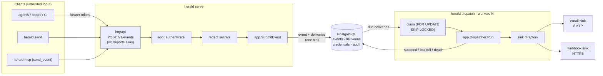

# Architecture

Herald is a self-hosted gateway that lets coding agents notify you when they
finish work. An agent submits an **Event** over HTTPS; the gateway authenticates
the token, redacts secrets, stores the event and one delivery per configured
sink, and a separate dispatcher process delivers them (email via SMTP, or an
outbound webhook). The recipient is resolved server-side from the token, so an
agent cannot choose where a notification goes.

The design is deliberately small: one Go binary, one PostgreSQL database, no
message broker. PostgreSQL is the durable queue, the audit log, and the
credential store.

## Diagram



Terminal-friendly version of the same flow:

```
agents / CLI / MCP / herdr plugin
        │  HTTPS  POST /v1/events        (Bearer token)
        ▼
   herald serve ── authn · redact · fan-out ──► PostgreSQL (queue + audit)
        │                                            │
        │  claim (SELECT … FOR UPDATE SKIP LOCKED)   │
        ▼                                            ▼
   herald dispatch ──► email sink (SMTP) · webhook sink (HTTPS)
   (separate process, --workers N)
```

## Layering

Dependencies point inward only. The domain knows nothing about infrastructure.

```
cmd/herald ──► internal/cli ──► internal/app ──► internal/domain
                    │                ▲
                    └──► internal/adapters/* (postgres, httpapi, sink,
                                             memory, hash, secret, id)
```

| Package | Responsibility |
|---|---|
| `internal/domain` | Pure model: `Event`, `Delivery`, `Principal`, `Token`, `Status`, redaction rules. No I/O, no infrastructure imports. |
| `internal/app` | Use cases (`SubmitEvent`, `Dispatcher`, token issuance) and the ports they depend on (`EventStore`, `DeliveryStore`, `CredentialStore`, `Sink`, `Clock`, …). |
| `internal/adapters/postgres` | Durable store: schema + migrations, queue claim/update, credentials, audit. |
| `internal/adapters/httpapi` | HTTP API: routing, auth extraction, JSON validation, rate-limit headers, error codes. |
| `internal/adapters/sink` | Email (SMTP) and webhook sinks, plus the sink directory that maps a project to its enabled sinks. |
| `internal/adapters/memory` | In-memory stores and rate limiter for `--dev` and tests. |
| `internal/adapters/hash` | SHA-256 hashing of credentials at rest. |
| `internal/adapters/secret` | High-entropy token-secret generation. |
| `internal/adapters/id` | ID generation. |
| `internal/cli` | Command dispatch: `serve`, `dispatch`, `send`, `token`, `login`, `mcp`, `skill`. |
| `internal/client` | HTTP client used by `send` and the MCP server. |
| `internal/credentials` | Per-user `0600` credential file holding the bearer token written by `herald login`. |
| `internal/mcp` | stdio MCP server exposing the `send_event` tool. |
| `internal/skill` | The agent `SKILL.md` that teaches a harness when to notify. |
| `internal/render` | Email templates (HTML + text). |
| `internal/config` | Loads and validates `gateway.toml` / `herald.toml`. |

## Submit flow (API)

1. `POST /v1/events` (or the deprecated alias `POST /v1/reports`) with a
   `Bearer` token and a JSON body.
2. The token is hashed and looked up; its tenant, scope and project are resolved.
   A bad, revoked, or out-of-scope token gets `401` and never reaches the queue.
3. The body is validated against the domain rules (title, body length, link
   count, status, agent) — errors map to `400/413/415/422`.
4. Rate limits are checked per `(tenant, project)`; an exhausted limit returns
   `429` with `X-RateLimit-*` and `Retry-After`.
5. Secret-looking strings are redacted from the free-text fields; the redacted
   copy is what gets stored and rendered.
6. `app.SubmitEvent` builds the `Event` and one `Delivery` per enabled sink, then
   saves them atomically. A stable `occurrenceId` (or legacy `idempotencyKey`),
   scoped to `(tenant, project)`, dedupes retries and returns the original id.
7. The API responds `202 {"id": …}`. Delivery happens asynchronously.

## Delivery flow (dispatcher)

1. `herald dispatch` claims a batch of due deliveries with
   `SELECT … FOR UPDATE SKIP LOCKED`, moving each to `inflight` under a lease.
2. Each delivery is handed to its `Sink`, which renders and sends the payload
   (email or webhook) with an `Idempotency-Key` header.
3. On success the delivery becomes `delivered`; on failure it returns to
   `pending` with capped backoff, or becomes `dead` after 8 attempts or on a
   permanent error. Expired leases are reclaimed, giving at-least-once delivery.

Delivery states: `pending → inflight → delivered` (or `→ pending` on retry, or
`→ dead`). Sinks are idempotent-friendly but consumers should still tolerate
duplicates.

## Cross-cutting conventions

- **Untrusted content.** Event titles, bodies, links and context are
  attacker-controlled data. They are never interpreted as instructions, and
  secret-looking strings are redacted before storage and delivery.
- **Server-pinned recipients.** Sink destinations come from the token and
  `gateway.toml`, never from the request body.
- **Explicit errors, context everywhere.** Use cases take a `context.Context`;
  errors are wrapped with `%w` and classified (`retryable` vs `permanent`).
- **Migrations are versioned and forward-only.** See
  [docs/migrations.md](docs/migrations.md); startup applies them under an
  advisory lock and verifies checksums.
- **Rate limiting is in-memory.** Correct for a single `herald serve` instance;
  see [docs/rate-limiting.md](docs/rate-limiting.md).

For decisions and known limits, see
[DECISIONS-AND-BLOCKERS.md](../DECISIONS-AND-BLOCKERS.md). For running the stack,
see [docs/self-hosting-docker.md](self-hosting-docker.md).
